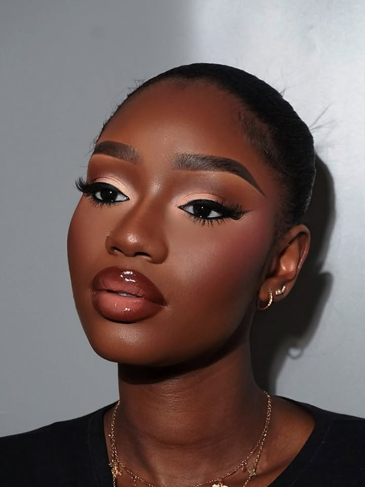
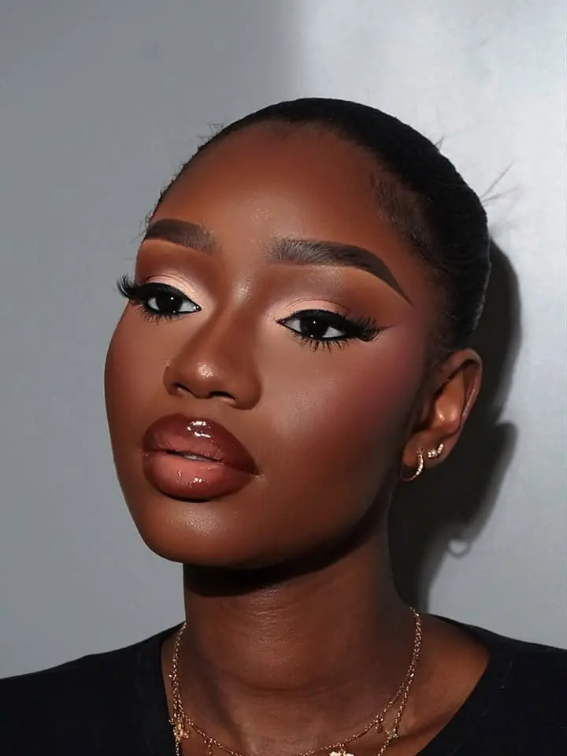

# mMardy Beauty - site vitrine

Site vitrine statique de **mMardy Beauty**, professionnelle de la beaute a Porto-Novo :
maquillage, coiffure et perruques, onglerie et soins du visage. Les prestations se
prennent sur rendez-vous, a son domicile ou en deplacement, a Porto-Novo et a Cotonou.
Le contact se fait par WhatsApp et par telephone, sans panier ni paiement en ligne.

Aucun framework, aucun build, aucune dependance externe : uniquement HTML5, CSS3 et
JavaScript natif.

## Lancer le site

### Ouverture directe

Ouvrir le fichier `index.html` dans un navigateur (double-clic ou
`Fichier > Ouvrir`). Toutes les pages fonctionnent en `file://`.

### Serveur statique (recommande)

Un serveur local restitue des conditions proches de la production :

```bash
cd mardy-beauty
python3 -m http.server 8000
```

Puis ouvrir <http://localhost:8000/>.

## Publication

Le site est publie par GitHub Pages depuis la branche `main` du depot
<https://github.com/g15365382-design/mardy-beauty>, a l'adresse :

<https://g15365382-design.github.io/mardy-beauty/>

Pour mettre le site a jour, modifier les fichiers puis :

```bash
git add -A
git commit -m "Description de la modification"
git push
```

GitHub reconstruit le site automatiquement en une minute environ.

## Structure du projet

```
mardy-beauty/
├── index.html              Accueil : hero, prestations, deroulement, teaser galerie
├── prestations.html        Les quatre prestations, detaillees sans tarif
├── galerie.html            Galerie filtrable (quarante photos liees a WhatsApp)
├── a-propos.html           Presentation, engagements, metier
├── contact.html            Formulaire qui ouvre WhatsApp + coordonnees
├── css/
│   ├── style.css           Variables de charte, mise en page, responsive
│   └── animations.css      Keyframes, apparitions, mouvements reduits
├── js/
│   ├── main.js             Menu mobile, entete collant, apparitions, formulaire
│   └── galerie.js          Filtres par categorie, compteur de visuels
├── assets/
│   ├── brand/
│   │   ├── logo.jpeg       Logo fourni : monogramme + nom sur fond creme
│   │   ├── logo-mono.jpeg  Logo fourni : badge rond + signature
│   │   ├── badge.png       Badge rond detoure, fond transparent (en-tete, pied)
│   │   ├── favicon.png     Favicon derive du badge
│   │   └── partage.jpg     Image d'apercu pour le partage de lien (1200 x 630)
│   └── images/
│       └── galerie/        Photos : .webp (servies) + .jpg (repli)
└── README.md
```

Tous les fichiers presents dans `mardy-beauty/` sont utilises par le site. Les
elements ecartes pendant la mise au point (illustrations vectorielles d'une
premiere maquette, textures de fond, page `produits.html`, quatre photos non
affichees) sont conserves hors du projet, dans `../mardy-beauty-fichiers-ecartes/`.
Ce dossier de sauvegarde peut etre supprime sans consequence.

## Pages

| Page | Contenu |
| --- | --- |
| `index.html` | Hero avec slogan et photo, quatre prestations en cartes, deroulement en trois etapes, teaser galerie, appel a l'action |
| `prestations.html` | Les quatre prestations en detail (maquillage, coiffure et perruques, onglerie, soins du visage) avec leurs atouts et un bouton WhatsApp par prestation, puis « Bon a savoir » sur la reservation. Aucun tarif affiche |
| `galerie.html` | Quarante photos filtrables par prestation (`maquillage`, `onglerie`, `soins`), compteur en region live ; chaque visuel ouvre WhatsApp avec son nom pre-ecrit |
| `a-propos.html` | Presentation a la premiere personne, quatre engagements, les quatre savoir-faire, appel a l'action |
| `contact.html` | Formulaire (nom, telephone, prestation, message) qui valide la saisie puis ouvre WhatsApp avec le message pre-rempli, coordonnees et questions frequentes |

## Remplacer les visuels

Toutes les pages utilisent de vraies photos, rangees dans `assets/images/galerie/`.
Chaque visuel est servi en WebP, avec le JPEG d'origine en repli :

```html
<picture>
  <source type="image/webp" srcset="assets/images/galerie/galerie-01.webp">
  
</picture>
```

Pour utiliser une autre photo, remplacer le fichier puis adapter l'extension dans
le HTML :

```html
<!-- avant -->


<!-- apres -->

```

Conseils de format :

| Emplacement | Fichier | Dimensions conseillees | Ratio |
| --- | --- | --- | --- |
| Accueil, portrait du hero | `galerie-01` | 700 x 875 minimum | 4 / 5 |
| Accueil, vignette du hero | `galerie-08` | 500 x 500 minimum | 1 / 1 |
| Accueil, teaser galerie | `galerie-12`, `galerie-08`, `galerie-18` | 700 px de large minimum | 4 / 5 |
| Prestations et A propos, visuel du duo | `galerie-33`, `galerie-10`, `galerie-36`, `galerie-21`, `galerie-13` | 700 px de large minimum | 4 / 5 |
| Galerie | `assets/images/galerie/galerie-01` a `-44` | 700 px de large minimum | libre |
| Logo, en-tete et pied | `assets/brand/badge.png` | 256 x 256 | 1 / 1 |
| Favicon | `assets/brand/favicon.png` | 128 x 128 | 1 / 1 |

Les visuels des blocs « duo » (page Prestations, page A propos) sont cadres en 4 / 5
et recadres par `object-fit: cover`. Penser a mettre a jour l'attribut `alt` de chaque
image lors du remplacement : il doit decrire le visuel reel.

## Identite visuelle

Le nom s'ecrit **mMardy Beauty** (m minuscule, comme sur le logo fourni). Le slogan
« Revelez votre eclat » est affiche sur la page d'accueil.

Les pages n'utilisent pas directement les JPEG de `assets/brand/` : le fond creme a
ete retire pour obtenir un badge detoure et net.

| Fichier servi | Role | Origine |
| --- | --- | --- |
| `assets/brand/badge.png` | Badge rond dans l'en-tete et le pied de page, suivi du nom ecrit en texte (selectionnable et lisible par les lecteurs d'ecran) | Recadrage du badge de `logo-mono.jpeg`, fond creme supprime |
| `assets/brand/favicon.png` | Favicon 128 x 128 | Le meme badge, replace sur un fond creme |
| `assets/brand/partage.jpg` | Apercu affiche quand un lien du site est partage sur WhatsApp, Facebook ou X | Composition 1200 x 630 montee avec ImageMagick |

Regeneration du badge (Python + Pillow) :

```python
from PIL import Image
import numpy as np

SEUIL = 60
src = Image.open("assets/brand/logo-mono.jpeg").convert("RGB")
fond = np.array(src.getpixel((2, 2)), dtype=np.float64)
zone = np.asarray(src.crop((334, 217, 690, 575))).astype(np.float64)
alpha = np.clip(np.abs(zone - fond).max(axis=2) / SEUIL, 0.0, 1.0)
couleur = np.clip((zone - fond * (1.0 - alpha)[..., None]) / np.maximum(alpha, 1e-3)[..., None], 0, 255)
Image.fromarray(np.dstack([couleur, alpha * 255.0]).astype(np.uint8), "RGBA").save("badge-brut.png")
```

Le fichier obtenu est ensuite recadre sur son contenu, centre dans un carre avec une
marge de 14 px, puis reduit a 256 x 256 px.

## Image de partage

Les reseaux sociaux ne savent pas lire une image en chemin relatif : les balises
`og:image` portent donc l'adresse complete du site. Elles pointent toutes vers
`assets/brand/partage.jpg`, une carte au format 1200 x 630 impose par les apercus
de lien. Ce format est incompatible avec les photos de la galerie, toutes en
portrait : d'ou cette image dediee, composee d'un panneau creme et d'un portrait.

L'adresse du site est repetee dans le `<link rel="canonical">` et les balises
`og:url` des cinq pages. Si le site change de domaine, remplacer partout
`https://g15365382-design.github.io/mardy-beauty/` par la nouvelle adresse.

Regeneration de la carte (ImageMagick) :

```bash
BASE=https://g15365382-design.github.io/mardy-beauty
# Blocs de texte rendus en 2x pour rester nets, puis ramenes a l'echelle 1x.
magick -background none -density 144 pango:'<span foreground="#6e3a4c" font="Liberation Serif Bold 72">mMardy Beauty</span>' t-titre.png
magick t-titre.png -resize 50% t-titre-1x.png
# Panneau creme 700 x 630 avec le badge, le surtitre, le titre, le slogan et les activites.
magick -size 700x630 xc:'#fbf7f4' t-titre-1x.png -gravity northwest -geometry +64+240 -composite panneau-creme.png
# Portrait 500 x 630, visage entier, puis juxtaposition avec un filet dore.
magick assets/images/galerie/galerie-01.jpg -resize '500x630^' -gravity north -extent 500x630 panneau-photo.png
magick panneau-creme.png -size 3x630 xc:'#b9922f' panneau-photo.png +append -resize '1200x630!' -quality 90 -strip -interlace Plane assets/brand/partage.jpg
```

Le script complet figure dans l'historique Git du depot.

## Ou modifier les textes

Les textes sont regroupes par page et nommes de facon explicite :

- **Prestations** : `prestations.html` (un paragraphe et trois atouts par prestation).
- **Textes de la galerie** : titres et legendes dans les elements
  `<figcaption class="carte-galerie__legende">` de `galerie.html`.
- **Presentation et engagements** : `a-propos.html`.
- **Coordonnees et questions frequentes** : `contact.html`, et le pied de page
  des cinq pages (WhatsApp, telephone, zone).
- Referencement : balises `<title>`, `<meta name="description">`, `og:*`,
  `twitter:card` et `<link rel="canonical">` en tete de chaque page.

## Images de la galerie

La galerie affiche quarante photos reelles, classees selon les prestations :

| Filtre (`data-filtre`) | Categorie des visuels (`data-categorie`) | Nombre |
| --- | --- | --- |
| Tout | toutes | 40 |
| Maquillage | `maquillage` | 32 |
| Onglerie | `onglerie` | 4 |
| Soins du visage | `soins` | 4 |

Il n'existe pas encore de filtre « Coiffure » : aucune photo de coiffure n'est
disponible pour le moment. En ajouter une revient a deposer les fichiers puis a
creer le bouton `<button class="filtre" data-filtre="coiffure">` et les visuels
portant `data-categorie="coiffure"`.

Chaque visuel est enveloppe dans un lien WhatsApp dont le message reprend le titre
de la photo :

```html
<a class="carte-galerie__bouton" href="https://wa.me/22946543406?text=Bonjour%20mMardy%20Beauty...%20%3A%20Regard%20bronze."
   target="_blank" rel="noopener" aria-label="Demander ce look sur WhatsApp : Regard bronze">
```

Le texte du message est encode dans l'attribut `href` (`%20` pour les espaces,
`%3A` pour les deux-points). Pour le modifier, regenerer les URL de la meme facon.

WhatsApp ne permet pas de joindre un fichier image depuis un lien : seul le texte
du message peut etre pre-rempli.

Pour ajouter une photo : deposer le `.jpg` et son `.webp` dans
`assets/images/galerie/`, puis dupliquer une `<figure class="carte-galerie">`
dans `galerie.html` en ajustant `data-categorie`, `src`, `alt`, `width`,
`height` et la legende. Le compteur `#compteur-galerie` se met a jour
automatiquement.

Quatre photos du dossier ne sont volontairement pas affichees : un visuel
etranger au sujet (un chat), une image trop petite pour etre agrandie
(235 x 289 px) et deux visuels publicitaires d'autres marques. Elles sont
rangees dans `../mardy-beauty-fichiers-ecartes/photos-non-utilisees/` ; les
remettre dans `assets/images/galerie/` suffit a pouvoir les integrer.

## Rendez-vous et contact

Le site fonctionne comme une vitrine : aucun panier, aucun paiement et aucun
tarif affiche. Le rendez-vous se prend par WhatsApp ou par telephone.

Le numero de WhatsApp est centralise dans les liens `wa.me/22946543406` :

- bouton flottant en bas a droite de chaque page (`.bouton-flottant`) ;
- boutons de section (`.bouton--whatsapp`) ;
- bouton « Demander cette prestation » de `prestations.html` et des cartes de la
  page d'accueil (`.lien-whatsapp`) ;
- liens des visuels de la galerie (`.carte-galerie__bouton`).

Pour changer de numero, rechercher `22946543406` dans les cinq pages HTML et dans
`js/main.js` (constante `NUMERO_WHATSAPP`).

Le formulaire de `contact.html` ne transmet rien a un serveur : apres validation,
il compose un message et l'ouvre dans WhatsApp. Les textes de reference se
modifient dans la fonction `composerMessage` de `js/main.js`.

## Charte graphique

Tout est pilote par variables CSS dans `css/style.css`, section 1 :

| Variable | Role |
| --- | --- |
| `--couleur-creme`, `--couleur-creme-fonce` | Fonds de page et d'alternance |
| `--couleur-rose-poudre`, `--couleur-rose-clair` | Accents doux, survols |
| `--couleur-prune`, `--couleur-prune-fonce` | Titres, boutons, pied de page |
| `--couleur-framboise` | Liens survoles et extremite claire du degrade des boutons |
| `--couleur-dore`, `--couleur-dore-clair` | Degrade des medaillons et des puces |
| `--couleur-dore-texte` | Surtitres : or volontairement assombri pour rester lisible |
| `--couleur-bordure` | Contours decoratifs des cartes |
| `--couleur-bordure-champ` | Contours des champs de saisie, plus contrastes |
| `--couleur-succes`, `--couleur-erreur` | Messages de confirmation et d'erreur du formulaire |
| `--police-titre`, `--police-corps` | Georgia pour les titres, police systeme pour le texte |

Modifier ces variables suffit a changer l'ensemble de la charte. Comme ces couleurs
sont choisies pour respecter les rapports de contraste de la section suivante,
toute modification demande de les reverifier.

## Animations et accessibilite

- Apparition des sections au defilement via `IntersectionObserver`
  (attribut `data-reveal` dans le HTML).
- Menu mobile anime sous 768 px, navigation clavier, fermeture par `Echap`,
  defilement de la page verrouille tant que le menu est ouvert. Entre 768 px et
  1099 px, le menu resserre ses entrees pour rester sur une seule ligne.
- Galerie : chaque visuel est un lien vers WhatsApp qui ouvre un nouvel onglet
  (`target="_blank" rel="noopener"`) et porte un nom accessible explicite
  (« Demander ce look sur WhatsApp : ... »). Sur les appareils tactiles
  (`@media (hover: none)`), le libelle reste affiche en permanence.
- Formulaire : messages d'erreur relies aux champs par `aria-describedby`,
  focus amene sur le premier champ invalide.
- Toutes les animations sont neutralisees si le visiteur a active
  `prefers-reduced-motion: reduce`.

### Contrastes

Les couples texte/fond respectent WCAG 2.1 AA : rapport minimal de 4,5:1 pour le
texte, de 3:1 pour le contour des champs de saisie. Rapports mesures (luminance
relative, seuil 4,5:1) :

| Element | Fond | Rapport |
| --- | --- | --- |
| Texte courant `#3a2a31` | creme / creme fonce / blanc | 12,7 / 11,5 / 13,5 |
| Texte doux `#6f5a62` | creme / creme fonce / blanc | 6,0 / 5,4 / 6,3 |
| Titres prune `#6e3a4c` | creme / creme fonce / blanc | 8,3 / 7,5 / 8,9 |
| Surtitre or `#826621` | creme / creme fonce / blanc | 5,1 / 4,6 / 5,4 |
| Liens framboise `#ac445d` | creme / creme fonce / blanc | 5,3 / 4,8 / 5,6 |
| Blanc sur le degrade des boutons | extremite claire `#ac445d` | 5,6 |
| Bordure des champs `#b0846d` | blanc / creme | 3,3 / 3,1 |

Deux jetons existent uniquement pour cela : `--couleur-dore-texte`, car l'or
decoratif `--couleur-dore` plafonne a 2,7:1, et `--couleur-bordure-champ`, car la
bordure decorative ne depasse pas 1,3:1 et resterait invisible sous un champ.

## Limites connues

- Le site n'a pas de serveur : le formulaire ouvre WhatsApp, mais aucune donnee
  n'est transmise ni stockee par le site.
- Le site ne comporte pas de panier ni de paiement en ligne, et n'affiche aucun tarif.
- Aucune photo de coiffure n'est disponible pour le moment : la prestation est
  presentee, mais la galerie ne la filtre pas encore.
- Certaines photos de la galerie comportent la signature ou l'habillage d'autres
  createurs. Elles sont conservees en attendant le choix de la cliente.
- Le site n'existe pas sur les reseaux sociaux : WhatsApp et le telephone sont les
  seuls canaux, et il n'y a pas d'adresse electronique.
- Le site est publie sur GitHub Pages, a l'adresse
  <https://g15365382-design.github.io/mardy-beauty/>. Cette adresse est repetee
  dans les balises `og:url` et `canonical` des cinq pages : passer sur un nom de
  domaine propre demande de les mettre a jour.
